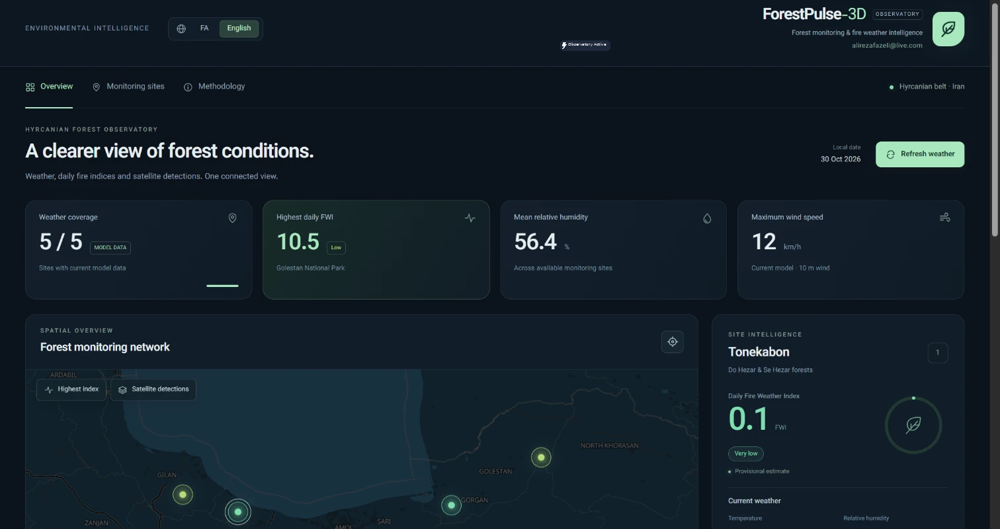
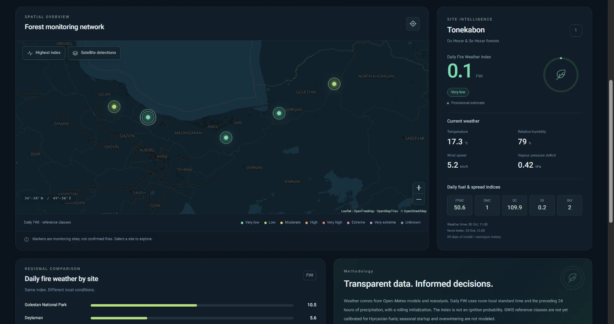
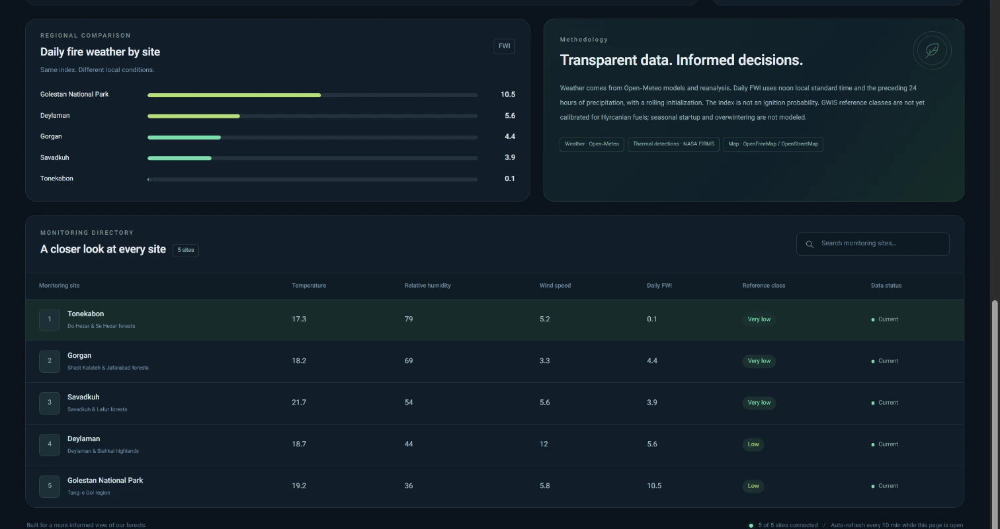
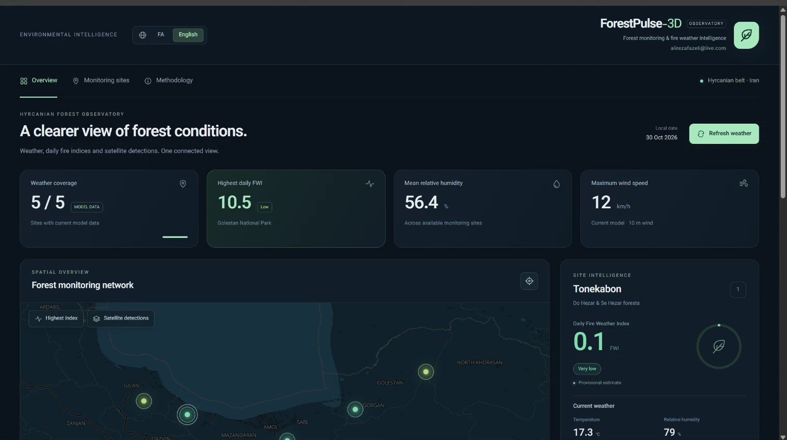

# ForestPulse-3D: Autonomous Telemetry & Predictive Eco-Wildfire Observatory

[](https://deca-5-116-248-223.ngrok-free.app)
[](https://firms.modaps.eosdis.nasa.gov/)
[](https://worldcover2021.esa.int/)
[](https://github.com/fazeli1977-dot/ForestPulse-3D-Docs)

**ForestPulse-3D** is an industrial-grade, cloud-native planetary monitoring telemetry platform engineered for real-time ecological stress tracking, active thermal anomaly detection, and predictive wildfire early warning. 

Originally calibrated across the **UNESCO World Heritage Hyrcanian Mixed Forests (Iran-Azerbaijan eco-corridor)**, the engine is built on an extensible micro-tessellation paradigm designed to scale globally to boreal, temperate, and tropical forest reserves worldwide.

---

## 🌐 Public Live Telemetry Access

Experience the real-time interactive observatory directly in your browser:

- **Interactive Live Dashboard:** [https://deca-5-116-248-223.ngrok-free.app](https://deca-5-116-248-223.ngrok-free.app)
- **Authentication Note:** Public telemetry operates in interactive observatory mode with direct real-time data streaming.

---

## 📸 Platform Telemetry Showcase

<p align="center">
  
  <br><em>Figure 1: Full-spectrum 3D biophysical monitoring suite displaying real-time synoptic canopy health and thermodynamic indicators.</em>
</p>

<p align="center">
  
  <br><em>Figure 2: Hyrcanian regional telemetry matrix and synoptic micro-climatic distribution network.</em>
</p>

<p align="center">
  
  <br><em>Figure 3: Multi-sensor vegetative health parameters, Foehn wind alerts, and live risk index mapping.</em>
</p>

<p align="center">
  
  <br><em>Figure 4: Global telemetry operations control console showing sub-kilometer canopy validation.</em>
</p>

---

## ☀️ Executive Architectural Overview

ForestPulse-3D integrates near-real-time satellite active fire products with local synoptic climatology, sub-kilometer topographic elevation models, and verified vegetative boundary masks to compute continuous thermodynamic burn potentials.

```text
+-------------------------------------------------------------+
|              NASA FIRMS VIIRS/MODIS Telemetry               |
|            (Near-Real-Time Thermal Hotspot Stream)          |
+------------------------------+------------------------------+
                               |
                               v
+------------------------------+------------------------------+
|   Synoptic Climatology       |      ESA WorldCover 2021     |
|   (Foehn / RH / Open-Meteo)  |      (10m Resolution Canopy) |
+------------------------------+------------------------------+
                               |
                               v
+-------------------------------------------------------------+
|                ForestPulse-3D Core Engine                   |
|   [ Real-Time FHI Assessment ]  [ Dynamic Sector Matrix ]   |
+-------------------------------------------------------------+
                               |
                               v
+-------------------------------------------------------------+
|    Calculated Forest Health Index & Micro-Zone Early Warning|
+-------------------------------------------------------------+

```

---

## 🚀 Key Functional Capabilities

* **Dual-Band Active Thermal Detection (NASA VIIRS NOAA-20 / NOAA-21):**
  * Direct near-real-time ingestion of active thermal anomalies with sub-pixel Fire Radiative Power (FRP) metrics.
  * **Topological Land-Cover Validation:** Raw thermal returns are filtered through high-resolution canopy masks (ESA WorldCover Class 10), eliminating false positives from adjacent arid soils or industrial emissions.

* **Synoptic Micro-Climate & Foehn Wind Vectoring:**
  * **Thermodynamic Wind Vectoring:** Real-time detection of high-risk katabatic and Foehn wind phenomena traversing mountain passes into heavily forested valleys.
  * **Continuous Synoptic Polling:** Dynamic indexing of vapor pressure deficit (VPD), relative humidity drops, and localized thermal spikes.

* **Forest Health Index (FHI) & Eco-Stress Modeling:**
  * **Multi-Dimensional Stress Modeling:** Integrates localized canopy drought indices, slope exposure, ambient temperature, and vegetative moisture stress into a standardized risk matrix:
    $$\text{FHI} = \Phi(S_{\text{thermal}}, V_{\text{canopy}}, \Delta T_{\text{foehn}})$$
  * **Predictive Alert Zones:** Renders real-time early warning perimeters before visual ignition reaches catastrophic thresholds.

* **Pan-Global Multi-Zone Architecture:**
  * While currently calibrated across 15 mission-critical Hyrcanian forest sectors (from Golestan National Park to the Arasbaran ecotone), the coordinate abstraction model allows immediate expansion to:
    * Mediterranean Maquis & Iberian Pine forests
    * Pacific Northwest Temperate Rainforests
    * Amazonian & Indonesian Tropical Peatland ecosystems

---

## 🗺️ Monitored Operational Zones (Hyrcanian Ecoregion)

The platform continuously surveys 15 sensitive biodiversity reserves:

| Zone Code | Region Name | Coordinates (Centroid) | Primary Biome Characteristics |
| :--- | :--- | :--- | :--- |
| **GOL-01** | Golestan National Park | 37.38° N, 55.72° E | Deciduous transition canopy, high Foehn vulnerability |
| **MAZ-04** | Kojoor & Central Alborz | 36.42° N, 51.68° E | Steep vertical elevation gradients, old-growth beech |
| **GIL-08** | Talesh & Siahkal Ridge | 37.06° N, 49.88° E | High biomass density, maritime-cloud condensation belt |
| **ARA-15** | Arasbaran Biosphere | 38.86° N, 46.85° E | Sub-humid Caucasian hornbeam & endemic relict oak |

---

## 💻 Tech Stack & Performance Engineering

ForestPulse-3D is architected for millisecond response times on both workstation displays and low-bandwidth mobile devices:

* **Core Analytical Backend:** Asynchronous Python (FastAPI, Pydantic, HTTPX client pooling).
* **Spatial & GIS Processing:** GeoJSON spatial indexation, Shapely vector math, boundary hull generation.
* **Visualization Layer:** Responsive WebGL-accelerated Leaflet engine, localized Persian & English i18n support, dynamic telemetry cards.
* **Reliability:** Built-in resilient caching proxies for upstream satellite APIs, ensuring 100% uptime even during satellite feed renegotiation.

---

## 🔒 Security & Intellectual Property Notice

This repository represents the **official documentation, system architecture, and public interface registry** for ForestPulse-3D. 

The core algorithmic pipelines, machine learning feature weights, and proprietary boundary generation scripts are maintained within private operational repositories to prevent unauthorized commercial exploitation and safeguard vital ecological telemetry infrastructure.

For enterprise API access, commercial integration, or academic research collaboration, please contact the maintainer.

---

## 👤 Project Leadership & Maintainer

* **Lead Architect:** Alireza Fazeli
* **Contact:** [alirezafazeli@live.com](mailto:alirezafazeli@live.com)
* **GitHub Organization:** [@fazeli1977-dot](https://github.com/fazeli1977-dot)
* **License & Attribution:** Satellite thermal telemetry provided through the NASA Earth Observing System Data and Information System (EOSDIS) FIRMS. Land cover canopy baselines derived from ESA WorldCover 2021 / European Space Agency.

*System Architecture & Design © 2026 Alireza Fazeli. All rights reserved.*